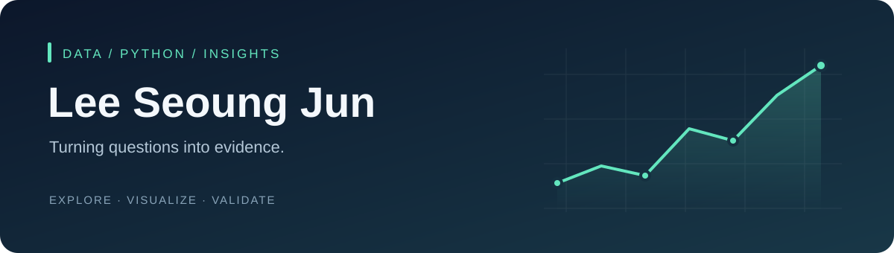

  

<h1 align="center">안녕하세요, 이승준입니다 👋</h1>

  <strong>데이터에서 질문을 찾고, 분석으로 답을 만들어갑니다.</strong> 
  Python으로 데이터를 수집하고, 시각화와 통계·머신러닝으로 탐구합니다.

  <a href="#-about">About</a> ·
  <a href="#-tech-stack">Tech Stack</a> ·
  <a href="#-selected-projects">Projects</a>

---

## 🌱 About

- **관심 분야** · 데이터 분석, 통계적 검증, 회귀 모델링, 시계열 예측
- **프로젝트 경험** · 게임 API 데이터, 소비자 피해구제 접수 데이터, Kaggle 예측 과제
- **분석의 기준** · 재현 가능한 과정, 기준 모델과의 비교, 결과와 한계를 함께 설명하기

## 🧰 Tech Stack

| 분야 | 프로젝트에서 사용하는 도구 |
| :--- | :--- |
| Language | **Python** |
| Data | pandas · NumPy |
| Visualization | Matplotlib |
| Statistics | SciPy · statsmodels |
| Machine Learning | scikit-learn · LightGBM · XGBoost |
| Workflow | Jupyter Notebook · GitHub · VS Code |

## ✨ Selected Projects

### 🎮 [League of Legends 개인 매치 분석](https://github.com/LeeSeoungJun/lol-data-analysis)
**직접 수집한 게임 데이터로 플레이 패턴을 탐구합니다.**

Riot Games API로 수집한 500경기 중 491경기를 분석했습니다. 플레이 지표와 승패의 관계, 챔피언별 승률을 살펴보고 통계 검정과 신뢰구간으로 해석의 범위를 확인했습니다.

`API 수집` `EDA` `통계 검정` `시각화`

### 🧾 [소비자 피해구제 접수 데이터 분석](https://github.com/LeeSeoungJun/consumer-complaints-kr)
**10만여 건의 접수 기록에서 시기와 품목별 패턴을 살펴봅니다.**

2023~2024년의 접수 사건 105,654건을 대상으로 기간·중복을 검증하고 월별 추이와 품목 내 청구이유 비율을 비교했습니다.

`데이터 품질 검증` `집계 분석` `공공데이터`

### 🛡️ [보험료 예측](https://github.com/LeeSeoungJun/Kaggle_Insurance_Price_Prediction)
**120만 행의 데이터로 회귀 모델과 기준 모델을 비교합니다.**

전처리를 Pipeline에 포함하고 모델 선택과 최종 홀드아웃 평가를 분리했습니다. Log-LightGBM의 홀드아웃 RMSLE는 **1.0487**, 기준 모델은 **1.0980**입니다. 해당 수치는 대회 리더보드 점수가 아닌 로컬 검증 결과입니다.

`회귀` `LightGBM` `Pipeline` `모델 검증`

### 📈 [스티커 판매량 예측](https://github.com/LeeSeoungJun/kaggle_ForecastingStickerSales)
**시간의 순서를 지키며 미래 판매량을 예측합니다.**

2015년을 모델 선택에, 2016년을 최종 검증에 사용했습니다. 전년 동일 월일 기준 모델과 XGBoost를 비교하고, 평가지표에 따라 모델의 장단점이 달라지는 점을 분석했습니다.

`시계열` `XGBoost` `기준 모델 비교`

---

  질문 → 데이터 → 분석 → 검증 → 전달

